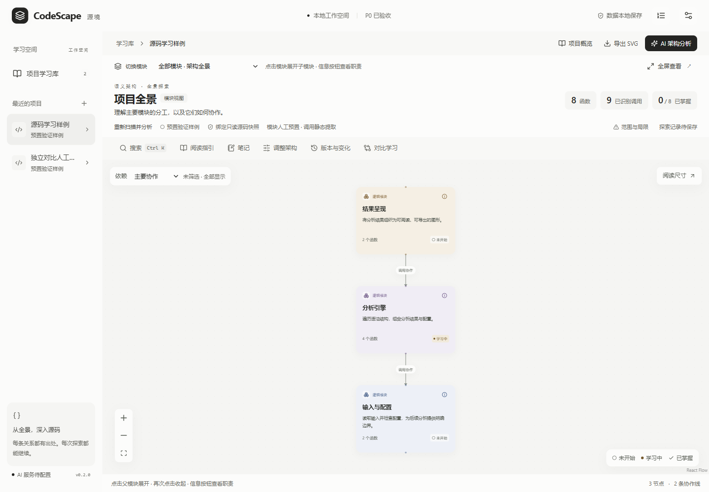
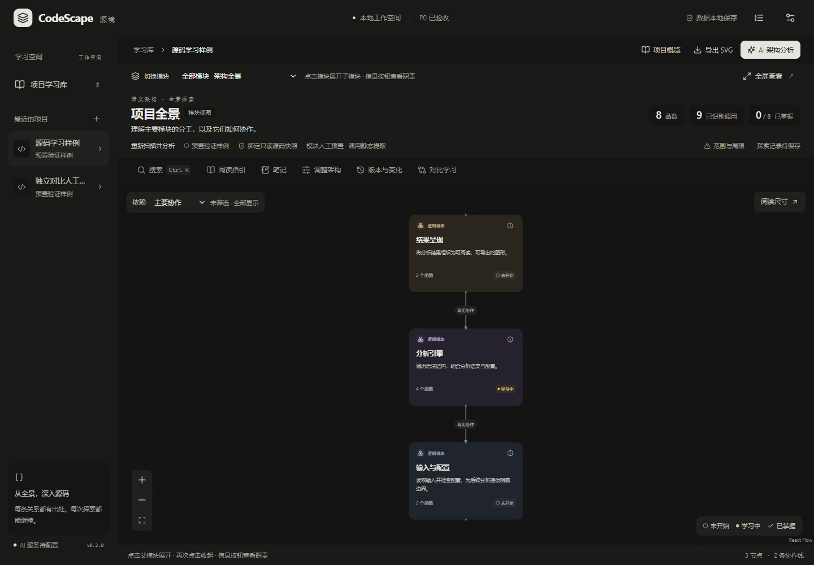
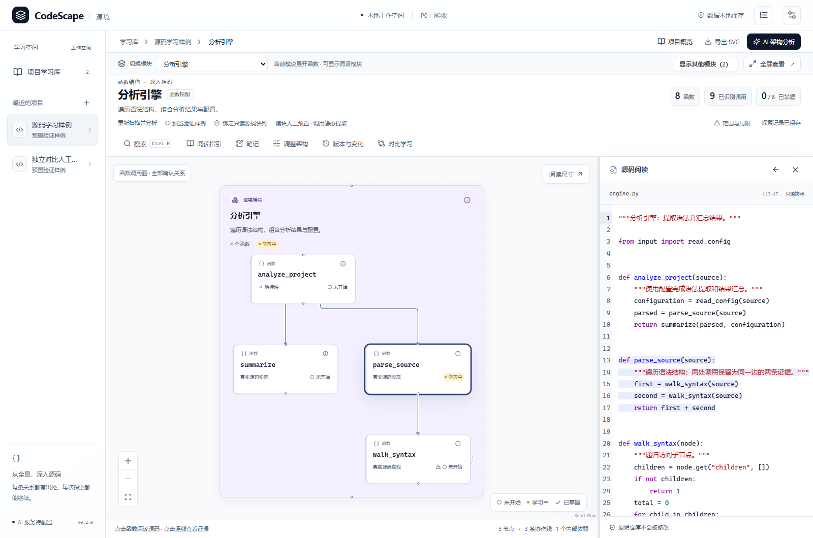
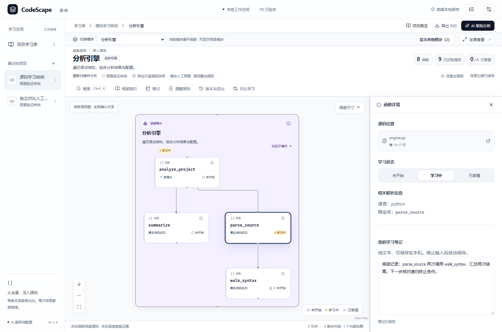
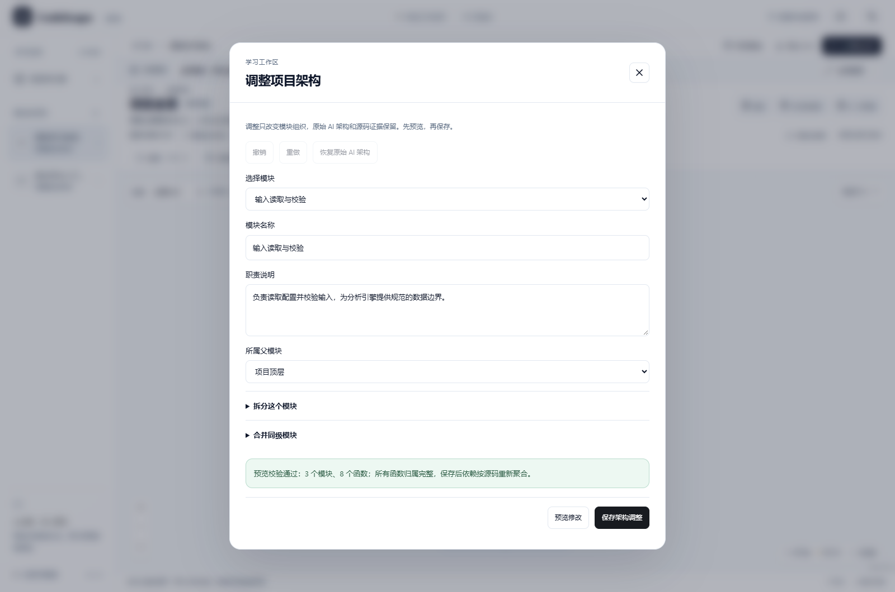
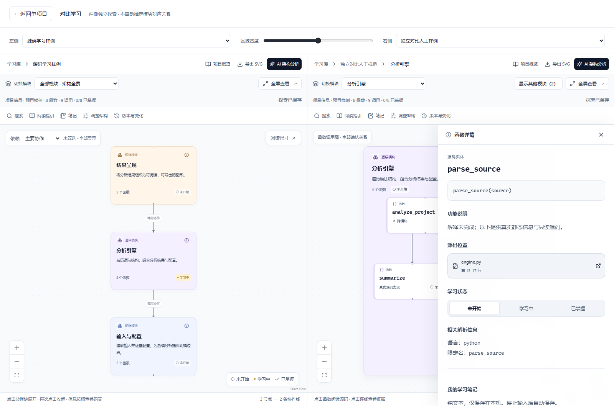
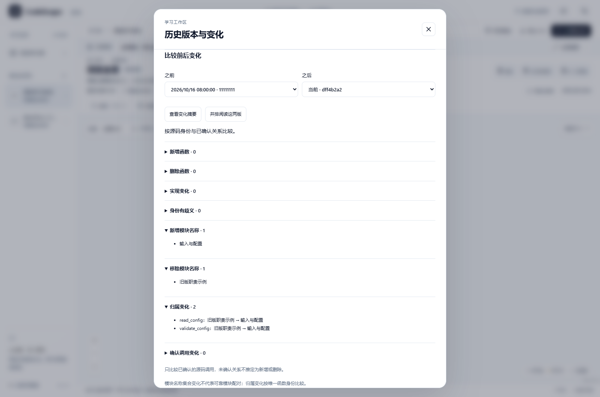
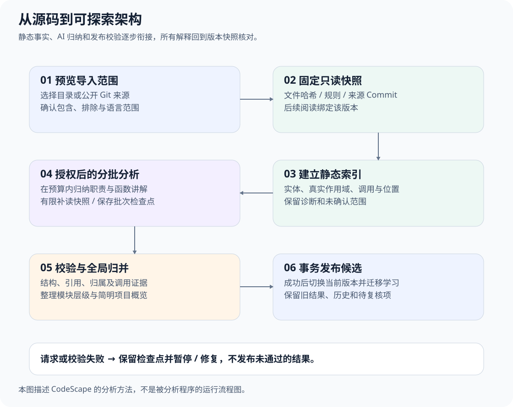
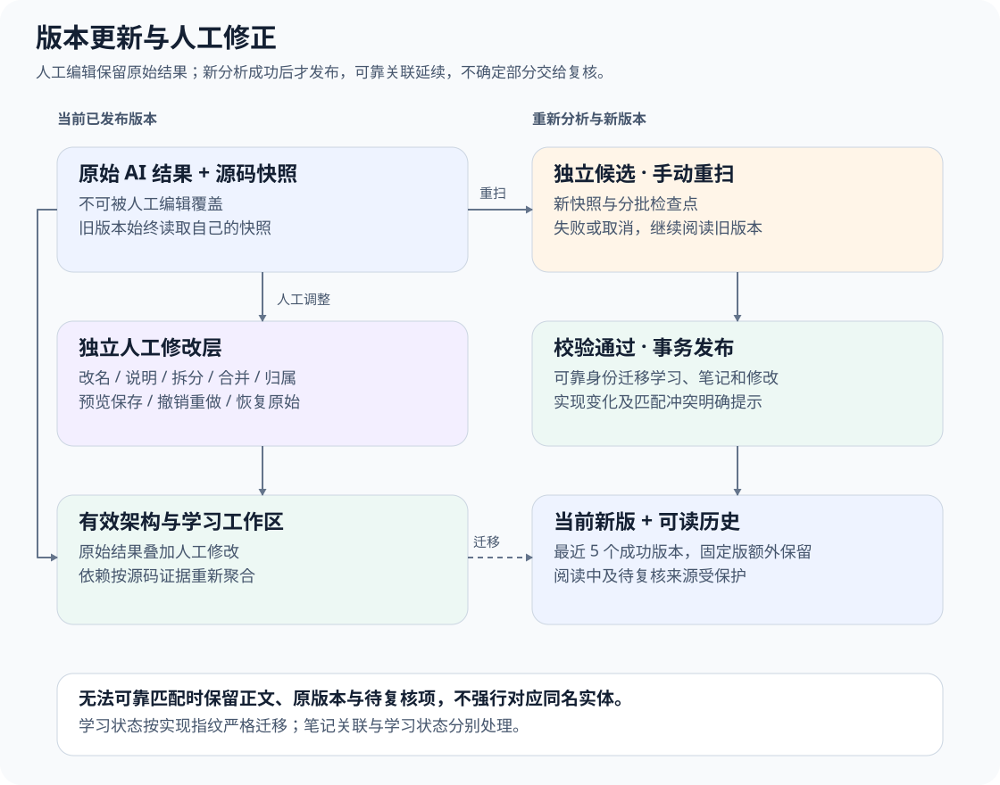
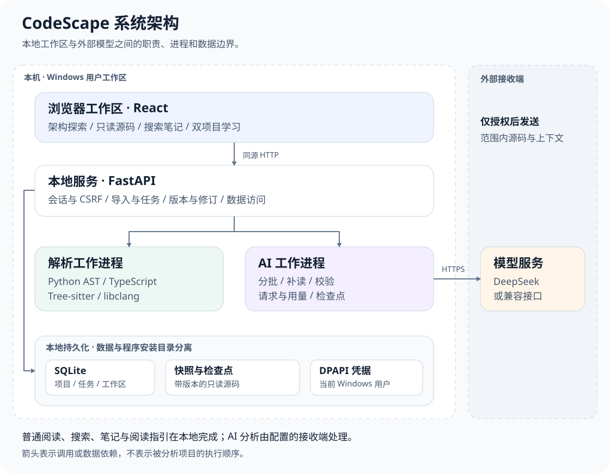

# CodeScape · 源境

**先看懂项目全貌，再沿真实源码证据逐层深入。**

CodeScape 是面向 Windows 的本地源码学习工作区。它把静态解析与 AI 归纳结合起来，将项目组织为可探索的模块与函数图，让你阅读源码、核对依赖、记录理解，并在代码更新后继续学习。

适合初次接触陌生仓库、接手已有项目，或希望从整体架构理解实现细节的开发者。你可以修正 AI 的模块划分，也可以并排阅读两个项目或同一项目的两个版本。

**最新发布版：0.2.0** · [下载安装](https://github.com/nan-yizjm/CodeScape/releases/tag/v0.2.0) · [版本说明](docs/releases/v0.2.0.md) · [源码启动](#development)

| 使用方式 | 当前包含的内容 |
| --- | --- |
| **下载 0.2.0 安装包／便携包** | 2026-10-17 发布的基础开发版本，包含搜索、笔记、架构调整、双项目与历史变化。 |
| **运行 `main` 源码** | 额外包含 2026-10-23 合入的浅深色材质与交互优化，以及分析中断后的批次续传修复。**这些更新尚未重制为安装包。** |

最新源码改进：跟随系统浅深色外观、优化折叠和复制反馈；分析按已保存的文件行范围恢复，避免已完成子批重复处理或未读源码被误判完成。详情见 [界面验收](docs/reports/frontend/材质与微交互验收.md) 与 [续传修复记录](docs/reports/分析续传与导出调查.md)。



> 首图及下方深色预览来自 10 月 23 日的 `main` 界面，其余功能截图保留 0.2.0 发布版外观。截图均使用隔离的人工预置样例：3 个文件、8 个可见函数，模块和概览为人工预置，调用由静态解析提取。它们不代表真实模型的归纳质量；本次文档更新没有上传源码或请求模型。

## 目录

- [界面展示](#screenshots)
- [核心能力](#features)
- [安装与快速开始](#quick-start)
- [首次使用教程](#first-project)
- [分析方法：从源码到可探索架构](#method)
- [系统架构](#architecture)
- [技术栈、仓库结构与接口](#engineering)
- [开发运行与检查](#development)
- [数据、安全与已知限制](#data-and-limits)
- [常见问题](#faq)
- [文档导航与版本留档](#documents)

<a id="screenshots"></a>
## 界面展示

<details>
<summary>查看当前 main 的深色工作区</summary>



浅深色外观跟随系统偏好，支持减少动画；源码阅读器同步切换配色。此界面尚未包含在现有 0.2.0 下载包中。

</details>

### 从模块进入实现，关系可核对到源码

画布同时展示至多两层。点击模块展开，点击外层模块收起并返回上一级；需要上下文时恢复同级模块。函数、调用证据和高亮源码在同一工作区阅读。



### 搜索、笔记与阅读建议

`Ctrl+K` 搜索模块、函数、路径、已有讲解与笔记；结果可以跨层定位。笔记自动保存在本机，阅读建议给出推荐理由与源码依据。

<details>
<summary>查看搜索定位与笔记界面</summary>



阅读建议是辅助阅读的候选顺序，不等同于程序真实入口或运行顺序。

</details>

### 调整架构、并排学习、查看历史

<details>
<summary>架构编辑：先预览影响，再保存修改</summary>



支持改名、修改说明、拆分、合并和归属调整，并提供撤销、重做及恢复原始架构。

</details>



<details>
<summary>历史版本：固定、只读阅读与变化摘要</summary>



示例历史由文档样例人工构造，用于展示版本界面，不代表一次真实模型重分析。

</details>

<a id="features"></a>
## 核心能力

| 你要做什么 | CodeScape 如何帮助你 |
| --- | --- |
| **理解项目** | 用通俗概览说明项目用途、主要职责和协作；从模块全景逐层深入，大图提供阅读分组与主要依赖筛选。 |
| **阅读源码** | 查看函数签名、已有讲解、调用位置与目标实现；只读源码绑定版本快照，支持目标行高亮、全屏和当前视图 SVG 导出。 |
| **记录学习** | 本地搜索与阅读指引；模块、函数纯文本笔记；未开始／学习中／已掌握状态；恢复探索位置和详情阅读位置。 |
| **修正架构** | 人工改名、职责说明、拆分合并和调整归属；预览、撤销重做、恢复原始 AI 结果。依赖始终从已有源码证据重新聚合。 |
| **比较变化** | 双项目独立阅读；同项目历史对比实现、函数、归属和确认调用的变化；本地源码更新只提醒，不自动分析。 |

另外包含受控分批分析、可暂停与恢复的任务队列、请求用量账本、快照上传授权和历史版本固定。搜索、阅读指引、笔记及普通浏览本地完成，不额外调用模型。

<a id="quick-start"></a>
## 安装与快速开始

### 下载哪一个？

面向 **Windows 10/11 x64**，目前的独立运行与安装实测环境为 Windows 11。x86、原生 ARM64、macOS 和 Linux 不属于本版交付范围。

| 下载项 | 适用方式 |
| --- | --- |
| [安装包 Setup.exe](https://github.com/nan-yizjm/CodeScape/releases/download/v0.2.0/CodeScape-0.2.0-Windows-x64-Setup.exe) | 日常使用。按当前用户安装，提供开始菜单与可选桌面快捷方式。 |
| [便携包 Portable.zip](https://github.com/nan-yizjm/CodeScape/releases/download/v0.2.0/CodeScape-0.2.0-Windows-x64-Portable.zip) | 解压后运行 `CodeScape.exe`，无需安装向导。 |
| [SHA256SUMS.txt](https://github.com/nan-yizjm/CodeScape/releases/download/v0.2.0/SHA256SUMS.txt) | 校验下载文件是否完整。构建身份另见 [release-verification.json](https://github.com/nan-yizjm/CodeScape/releases/download/v0.2.0/release-verification.json)。 |

运行包已包含 Python、Node、Git、解析组件和前端资源，**普通使用无需另行安装开发环境**。安装包尚未签名，系统可能提示无法验证发布者。

### 几分钟体验

1. 安装时勾选“创建桌面快捷方式”，或解压便携包。
2. 双击 **CodeScape 源境**／`CodeScape.exe`，程序启动本地服务并打开浏览器。
3. 打开预置的“源码学习样例”，查看模块和调用证据；不配置模型也能体验这个人工样例。
4. 展开“分析引擎”，进入函数详情，查看源码高亮并写一条笔记。
5. 使用 `Ctrl+K` 搜索函数，或进入“对比学习”“版本与变化”了解其他工具。

端口默认自动选择；不要收藏带临时凭证的启动地址，后续直接使用快捷方式重新启动。重复启动会复用同一数据目录的服务。

**便携包指程序可解压运行，不代表数据写在解压目录。** 安装版与便携版默认均使用 `%LOCALAPPDATA%\CodeScape`，同一数据目录由单实例机制保护。

<a id="first-project"></a>
## 首次使用教程

### 1. 配置模型服务

打开右上角 **AI 服务设置**，填写 API Base URL、服务支持的模型 ID 和 API Key，再进行连接测试。默认适配 DeepSeek 官方接口 `https://api.deepseek.com`，也支持符合要求的 Chat Completions 兼容服务；Base URL 是否包含 `/v1` 取决于服务要求。

兼容服务需要支持 `/chat/completions` 和 JSON 对象输出。流式接收为可选项，需要服务兼容相应 SSE 结束标记与用量事件。连接测试不携带项目源码，但可能产生模型用量；连接成功也不等于架构质量已经验证。

Key 只通过当前 Windows 用户的 DPAPI 加密保存。不要把密钥写入仓库、`.env`、启动参数或截图。

### 2. 导入项目并确认范围

选择本地目录，或公开 Git 仓库默认分支。先预览包含／排除范围，确认文件数量、语言和被排除项，再创建只读快照。私有远程仓库可先自行克隆，再从本地目录导入。

CodeScape 不执行目标项目的安装、构建、测试或运行脚本，也不修改原目录。静态索引建立后仍需 AI 架构分析，不能把文件清单或索引当作已经理解项目。

### 3. 确认上传授权并观察任务

AI 分析前核对接收端、模型和快照范围，明确授权后才发送范围内源码与分析上下文。任务区域显示批次进度、暂停／恢复、取消和错误；已完成批次保留检查点。

当前 `main` 的检查点同时记录每批实际文件与行范围，恢复时核对源码覆盖再继续。旧格式缺少范围的可拆批次无法证明已读完整，会保留原记录并重新处理；损坏的检查点会明确暂停，不静默清空。

等待队列不会因为前一项完成就自动启动下一项。恢复任务可能继续产生模型费用；请求账本保留实际尝试和可获得的用量，缺少价格或用量时显示未知。

### 4. 从项目概览进入架构

先看“项目是什么、做什么”，再浏览主要模块。点击模块展开，点击外层模块返回上一级；“显示其他模块”恢复当前外层的同级上下文。

点击连线核对调用位置和目标实现。主要协作筛选只改变展示范围；需要时切换完整关系。自动阅读分组帮助浏览大图，不等于新增的 AI 职责结论。

### 5. 深入源码并记录理解

点击函数或详情中的源码引用，阅读当前版本的只读全文与高亮行。`Ctrl+K` 快速定位，`Esc` 关闭搜索或退出全屏。阅读指引可跳过，不要求按固定路线学习。

笔记停止输入后自动保存，状态会提示保存中、已保存或失败。并发修改需要显式合并；失败时先保留草稿并重试，不要直接关闭页面。成功保存的笔记可跨重启恢复，未保存的浏览器会话草稿不保证关闭浏览器后仍存在。

### 6. 修正架构，比较更新

“调整架构”可以修改模块名称、说明和成员组织，必须先预览校验再保存；可以撤销、重做或恢复原始架构，不添加自定义依赖。

“对比学习”选择另一个已有架构的项目，两侧独立操作，通过顶部宽度滑块调整比例；窄屏切换左右侧，不自动配对模块或生成 AI 对比总结。

“版本与变化”可固定、查看或删除历史版本，选择两版查看变化摘要或并排阅读。本地源码在打开项目、页面回到前台及前台每 60 秒检查一次；发现变化只提示，由你发起重新扫描和分析。远程 Git 只在主动检查时联网，不自动拉取或合并。

<a id="method"></a>
## 分析方法：从源码到可探索架构



这是一张 **CodeScape 分析方法图**，不是被分析程序的执行流程图。

| 阶段 | 做什么 | 保留什么依据 |
| --- | --- | --- |
| **范围与快照** | 按规则筛选源码，复制到应用数据目录；Git 导入记录 Commit。 | 文件哈希、包含／排除规则、来源和快照身份。 |
| **静态解析** | Python AST、TypeScript Compiler API、C/C++ 语法与语义解析提取实体、作用域和调用。 | 路径、行范围、真实调用作用域、确认目标及诊断缺口。 |
| **受控分批分析** | 按上下文预算拆分，归纳模块、职责、讲解和协作；模型只能有限补读授权快照。 | 各批检查点、已提供的源码范围、实际请求身份与用量。 |
| **校验与归并** | 检查结构、源码引用、实体归属、调用判断与部分语义事实，再做全局组织和简明概览。 | 可回溯到源码的解释与关系；跨批和不确定部分明确提示。 |
| **候选发布** | 新分析在独立候选中进行，通过发布条件后事务切换当前版本。 | 原成功结果、版本快照、迁移报告与待复核项。失败不覆盖旧结果。 |

### 三种内容，三种含义

- **静态事实**：解析器确认的实体、位置、作用域和调用。动态分派等无法确认时保留缺口，不凭名字画边。
- **AI 解释与判断**：模块职责、函数讲解、概览及有证据的补充判断。保留来源与引用；引用有效不代表解释必然正确。
- **人工修改**：独立调整模块组织和文字，保留原始 AI 结果；函数不能遗漏、重复归属或形成循环层级，关系从原证据重新聚合。

### 更新后如何继续学习？



学习状态按唯一身份和实现指纹严格迁移。笔记关联单独处理：可靠匹配可跟随新版，实现变化提示复核，无法匹配则进入“待重新关联”，正文不会直接丢弃。人工结构不能可靠迁移时保留冲突与原版本，不强行对应同名对象。

版本差异按唯一源码身份比较新增、删除、实现变化和归属变化；确认调用变化保留可复核依据，人工调整单独标识。模块名称集合变化不等同于可靠的模块配对。

<a id="architecture"></a>
## 系统架构



| 组件 | 职责 |
| --- | --- |
| **浏览器工作区** | React 交互、架构导航、详情、搜索、笔记、源码阅读与比较；React Flow 绘图，ELK 在 Web Worker 中布局。 |
| **本地服务** | FastAPI 提供同源 API，管理导入、身份与 CSRF 校验、任务、版本、读写修订和数据访问。 |
| **解析工作进程** | 静态读取快照，执行 CodeScape 自身解析器；保留声明、真实作用域、语言边界和诊断。不会运行目标代码。 |
| **AI 工作进程** | 在授权范围内构造批次、补读、请求、校验和检查点；经配置的模型服务获取归纳结果。 |
| **持久化** | SQLite 与 Alembic 保存项目、任务和工作区文档；文件系统保存源码快照及检查点；DPAPI 加密凭据。 |

服务监听回环地址，端口默认自动选择；浏览器通过一次性启动入口建立会话。多页面各自保活，最后页面失联并经过保存宽限后暂停任务、退出服务。Windows Job Object 管理工作进程的资源和生命周期；它不用于执行目标项目，也不是目标代码执行沙箱。

外部模型不是必须常驻的本地组件。**应用在本地运行，不等于 AI 在本地推理**：执行 AI 分析时，授权范围内的源码会发到你配置的接收端；普通阅读、搜索、笔记和阅读指引不请求模型。

<a id="engineering"></a>
## 技术栈、仓库结构与接口

### 技术栈

| 层次 | 采用的技术 |
| --- | --- |
| 前端 | React 19、TypeScript、Vite 7 |
| 图与源码 | React Flow、ELK Web Worker、CodeMirror 6 |
| 本地服务 | Python 3.12、FastAPI、Uvicorn、Pydantic、httpx |
| 数据 | SQLite、SQLAlchemy 2、Alembic |
| 静态解析 | Python AST、TypeScript Compiler API、Tree-sitter、libclang |
| Windows 交付 | PyInstaller、Inno Setup、DPAPI、Job Object |
| 检查 | pytest、Ruff、Vitest、TypeScript、Playwright 隔离界面验证 |

具体依赖以 `uv.lock` 和 `package-lock.json` 为准。

### 仓库结构

```text
CodeScape/
├─ apps/web/             前端工作区、图布局、源码与学习工具
├─ server/codescape/     本地 API、解析调度、AI 流水线与持久化
├─ analyzers/typescript/ TypeScript 静态解析入口
├─ tests/                CodeScape 测试及只用于读取的源码样例
├─ scripts/              构建、验证与应用自有资源准备脚本
├─ packaging/            Windows 打包配置、安装器与运行库清单
├─ docs/                 需求、设计、版本说明和验收记录
└─ Start-CodeScape.ps1   Windows 源码开发启动入口
```

### API 分组

API 统一位于 `/api/v1`，由本地应用会话保护，不是对外部署的公共服务。修改操作需要 CSRF，适用写操作还有幂等回执；笔记、架构及工作区采用修订号防止覆盖。

| 分组 | 代表路径 | 用途 |
| --- | --- | --- |
| 导入与项目 | `/imports/preview`、`/imports`、`/projects/{pid}` | 预览范围、创建快照、读取和删除项目。 |
| 模型与任务 | `/settings/ai`、`/tasks`、`/usage` | 配置、连接测试、任务管理及请求账本。 |
| 授权与分析 | `/projects/{pid}/consent`、`/projects/{pid}/analyze` | 显式授权快照并发起分析。 |
| 学习工具 | `/projects/{pid}/notes`、`/projects/{pid}/versions/{vid}/search`、`/projects/{pid}/versions/{vid}/guide` | 笔记、版本内搜索和本地建议。 |
| 架构与工作区 | `/projects/{pid}/versions/{vid}/architecture`、`/projects/{pid}/versions/{vid}/workspaces/{slot}` | 人工层及独立单页／左右状态。 |
| 历史与变化 | `/projects/{pid}/versions`、`/projects/{pid}/compare`、`/projects/{pid}/changes` | 版本、差异和源码变化检查；历史源码读取明确携带版本身份。 |

完整设计见 [开发设计](docs/CodeScape_Development_Design.md) 与 [0.2.0 工作区与数据设计](docs/0.2.0工作区与数据设计.md)。

<a id="development"></a>
## 开发运行与检查

### 从全新检出启动

需要 Windows x64、Git、Python 3.12、uv，以及 Node.js 22.12+ 或 24。以下命令在 PowerShell 中运行，依赖安装遵循仓库锁文件：

```powershell
git clone https://github.com/nan-yizjm/CodeScape.git
cd CodeScape
uv sync --frozen --python 3.12
npm ci
npm run build
```

开发时使用独立数据目录，避免迁移或更改日常使用数据：

```powershell
$env:CODESCAPE_DATA_DIR = Join-Path $PWD '.runtime\dev-data'
.\Start-CodeScape.ps1
```

脚本使用项目的 `.venv` 和生产前端资源，默认打开系统浏览器。固定端口可运行 `.\Start-CodeScape.ps1 -Port 8125`；`-NoBrowser` 只启动服务。使用 Ctrl+C 正常停止，勿将本地开发服务暴露到外网。

涉及 C/C++ 标准库声明的完整环境准备见 [Windows 构建与验证](packaging/README.md) 和 [CI](.github/workflows/检查.yml) 的锁定声明资源步骤。缺失依赖或声明时应查看诊断，不把未确认语义当作完整解析。

### 检查命令

```powershell
uv run ruff check server scripts tests
uv run pytest -q
npm run typecheck
npm test
npm run build
```

这些检查运行 CodeScape 本身；`tests/fixtures` 仅作静态读取输入，不执行其中项目。常规回归不产生模型费用。真实模型验证必须单独确认接收端、模型和源码上传范围，并与固定响应测试分开记录。

**0.2.0 已记录的验证结果**：后端 497 项、前端 38 项、Ruff、类型检查和生产构建通过；隔离浏览器覆盖 320–1920px、搜索、笔记异常恢复、架构调整、双侧隔离、历史、全屏与 SVG；开发机完成 0.1.1 → 0.2.0 升级和原数据保留验证。证据见 [0.2.0 开发与验收](docs/reports/0.2.0开发与验收.md)。这些是该版本的留档结果，不代表本次 README 修改新增的模型质量证明。

**`main` 截至 2026-10-23 的已记录验证结果**：后端 540 项、前端 53 项、Ruff、类型检查、生产构建及 GitHub CI 通过。新增验证包含动态拆批续传、长函数／纯文本／配置文件的行范围覆盖、旧检查点兼容和跨进程落盘恢复；界面验证覆盖浅深色、响应式、折叠及复制反馈。使用人工样例和固定响应，未新增真实模型请求。见 [分析续传验收](docs/reports/分析续传与导出调查.md) 和 [前端验收](docs/reports/frontend/材质与微交互验收.md)；这组结果不替代 0.2.0 安装包的留档记录。

Windows 构建、组件来源、安装器和独立运行验证请阅读 [打包说明](packaging/README.md)。普通使用直接下载发布包即可。

<a id="data-and-limits"></a>
## 数据、安全与已知限制

### 本机数据如何保存

| 内容 | 规则 |
| --- | --- |
| 默认位置 | `%LOCALAPPDATA%\CodeScape`；可用 `CODESCAPE_DATA_DIR` 指定独立目录。 |
| 原始源码 | 只读导入，不修改；后续阅读绑定快照，不跟随原目录悄然变化。 |
| Key 与配置 | Key 使用当前用户 DPAPI 加密，不进入源码、日志、命令行或 Git。跨 Windows 用户复制数据不能直接复用加密凭据。 |
| 笔记与工作区 | 成功保存的笔记持久化；左右视图、版本和修订隔离，冲突不静默覆盖。 |
| 历史保留 | 最近 **5 个成功分析版本（含当前）**；固定版本额外保留，正在阅读或有待复核修改的版本受保护。新分析成功后才整理超额历史。 |
| 历史清理 | 当前版本不可删除；空间按源码与记录估算。快照清理不删除笔记正文，文件占用时保留清理请求并重试。 |
| 升级与卸载 | 数据库迁移前建立技术恢复副本，失败停止并恢复；卸载保留应用数据。项目内的永久删除会包含笔记和历史，原目录不受影响。 |

需要自行备份时，先正常退出应用，再备份整个数据目录；不要只复制数据库而漏掉源码快照。技术恢复副本服务于迁移恢复，不替代你的长期备份。

### 使用前了解这些边界

- **语言与编码**：首批覆盖 Python、TypeScript、C/C++；当前源码要求不带 BOM 的 UTF-8。动态调用、宏、多配置和跨语言桥接有各自限制，不宣称完整覆盖。
- **覆盖与正确性**：任务结束不代表整个项目已被完整理解。被排除、解析失败、未确认和不支持的部分有单独说明；已有讲解仍需要结合源码判断。
- **历史真实性**：只有记录与快照完整的旧版本才开放，不会为升级前数据补造分析历史。
- **流程图**：0.2.0 未纳入程序运行流程图。现有图表达模块协作和调用依据，不能当作条件、循环、异步或动态执行顺序。
- **平台与评测**：安装器未签名；已记录的 Windows 11 开发机验证不等于完成干净 Windows 10/11 矩阵。固定响应、人工样例和大图性能测试不等于真实模型语义质量通过。

<a id="faq"></a>
## 常见问题

**没有 API Key 能使用吗？**

可以浏览人工预置样例和已完成架构，使用本地搜索、笔记及学习工具；对新项目生成 AI 架构需要配置可用模型服务并授权。静态索引不冒充已完成架构。

**程序打不开，或提示缺少运行组件？**

安装版可重新安装匹配版本；便携版应完整解压，不要只移动 exe。源码运行先确认 `.venv`、`npm ci` 和前端构建已完成。不要依赖上次的临时浏览器地址，重新使用启动入口。

**为什么看不到依赖线？**

可能处于主要协作筛选、相关模块被收起，或当前范围确实没有可确认调用。切换完整关系、恢复同级模块并查看“范围与局限”；不能确认的关系不会为美观补画。

**模型连接成功，为什么分析仍会暂停？**

连接测试只证明一次接口可用。上下文、超时、限额、输出格式或源码校验仍可能失败。查看具体错误和任务检查点，修正配置后按提示恢复，不必重新创建整个项目。

**恢复任务为什么又分析了一部分内容？**

当前 `main` 已修复动态拆批后丢失可复用进度的问题，新检查点按实际行范围继续。旧格式没有范围证明的批次可能重新处理并产生用量，以免跳过尚未读完的源码；检查点损坏时先保留文件并查看提示。[Issue #6](https://github.com/nan-yizjm/CodeScape/issues/6) 已修复合并，但现有 0.2.0 下载包尚不包含该修复。

**分析项目会自动下载 SVG 吗？**

不会。应用只在手动点击“导出 SVG”时下载当前视图；连续点击可能生成多份带数字后缀的文件。仓库文档里的 SVG 是说明图，不是分析时额外下载的产物。

**下载后为什么与首页的新界面不同？**

首页首图展示当前 `main` 源码。现有安装包和便携包仍是 0.2.0 发布版；需要提前体验源码更新时，请按上方开发步骤使用独立数据目录启动。

**为什么提示源码更新，却没有自动出现新架构？**

更新检查只提醒。重新扫描和分析需要你主动发起；候选成功发布前，旧结果保持可读。历史源码也始终是对应版本的原快照。

**笔记冲突或保存失败怎么办？**

保留当前编辑内容，使用界面的显式合并／重试入口。待重新关联的笔记可重新选择目标；成功保存前不要关闭浏览器。

**普通阅读会继续收费吗？**

浏览已有结果、搜索、笔记和阅读指引不请求模型。发起或恢复 AI 分析、连接测试等模型请求可能计费，以配置服务实际账单和本地可获得的用量为准。

**为什么双项目没有自动对齐，历史差异也不按同名强行匹配？**

双项目以自主阅读为主；历史比较只使用可靠身份和证据。同名不等于同一实现，有歧义时宁可提示，也不生成误导对应。

<a id="documents"></a>
## 文档导航与版本留档

| 资料 | 阅读目的 |
| --- | --- |
| [产品需求 PRD](docs/CodeScape_PRD.md) | P0 需求基线与产品边界；0.2.0 增量能力另见下面的版本设计。 |
| [开发设计](docs/CodeScape_Development_Design.md) | 分析流程、证据契约、任务、可靠性与实现记录。 |
| [0.2.0 工作区与数据设计](docs/0.2.0工作区与数据设计.md) | 笔记、人工层、版本身份、双侧隔离及新增 API。 |
| [0.2.0 开发与验收](docs/reports/0.2.0开发与验收.md) | 功能检查、实际边界、安装升级和原数据保留。 |
| [前端材质与微交互验收](docs/reports/frontend/材质与微交互验收.md) | 当前源码的浅深色、动效、响应式与前后截图。 |
| [分析续传与 SVG 调查](docs/reports/分析续传与导出调查.md) | 批次行范围恢复、旧检查点兼容、纠错反馈及导出行为。 |
| [测试计划](docs/CodeScape_Test_Plan.md) | 基线测试与验收方式。 |
| [Windows 打包](packaging/README.md) | 锁定运行库、构建与独立安装验证。 |
| [本页图示与截图](docs/readme/README.md) | 资源来源、图示重新生成及文档核验方式。 |

P0 已有用户验收记录；这不自动代表后续版本的 AI 质量或新增能力已经由用户验收。历史阶段与原始制品保留：

- [v0.2.0 · 基础开发收尾](https://github.com/nan-yizjm/CodeScape/releases/tag/v0.2.0)
- [v0.1.1 · 界面与桌面入口](https://github.com/nan-yizjm/CodeScape/releases/tag/v0.1.1)
- [v0.1.0-p0.2 · P0 第一版留档](https://github.com/nan-yizjm/CodeScape/releases/tag/v0.1.0-p0.2) · [P0 用户验收记录](docs/reports/p0/P0用户验收确认.json)
