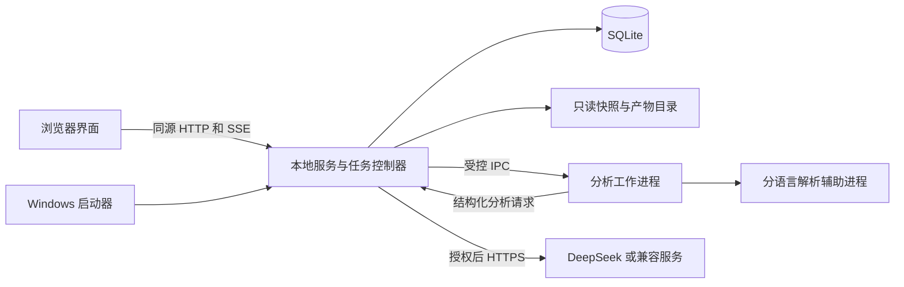

# CodeScape 开发设计文档

版本：v1.0  
日期：2026-10-09  
需求基线：[CodeScape_PRD.md](CodeScape_PRD.md) v1.1  
适用阶段：P0 实现、集成与交付验收。

本文件规定架构、分析流程、数据和接口契约、交互、可靠性、安全、打包及开发顺序。配套文件为 [测试与验收计划](CodeScape_Test_Plan.md) 和 [固定仓库样本清单](benchmark_sources.json)。技术设计已形成实施基线；功能尚未实现，解析质量、兼容性和性能必须通过验证，不以文档完成代替产品验收。

## 1 决策与范围

### 1.1 已确认决定

| 编号 | 用户决定 | 开发约束 |
|---|---|---|
| D-01 | AI 开发，用户验收 | 每阶段交付可运行版本、自动检查结果和操作式验收清单 |
| D-02 | 无指定技术栈，由开发方案选型 | 本文确定工程方案，依赖补丁版本在 M0 验证后锁定 |
| D-03 | 由开发方案选择验证仓库 | 真实仓库与小型边界样例共同验收 |
| D-04 | DeepSeek 为主，保留其他服务兼容 | 供应商适配与业务分析分离，不自动换模型 |
| D-05 | 理解质量优先 | 允许补充上下文、分层理解和有限复核 |
| D-06 | 首次分析没有固定时限 | 无任务总时长硬截止；有阶段进度、暂停和恢复 |

没有固定时限不等于无限重试。单次请求和解析进程受超时与资源限制，复核必须有停止条件。初始参数见第 15 节，可通过测试调整，不能静默缩减范围。

### 1.2 工程默认决定

以下由开发设计确定，不冒充用户逐项确认：仅普通注释或无语义影响的排版变化、可靠匹配且实现指纹相同时继承学习状态；实现或签名变化、匹配不确定时重置。不用 AI 自报置信分决定继承。

Windows 10/11 为交付平台，首个安装构建为 x64；发布说明列出实际测试的系统、CPU 架构和浏览器。原生 ARM64、x86 不宣称已经支持。Linux/macOS 不纳入 P0。

P0 保持 PRD 全部范围。搜索、笔记、主动 AI 问答、架构手动编辑、推荐路线、行为图、历史版本对比、双项目对比和私有 Git 凭据管理不增加到本次实现。

### 1.3 不变量

1. 图、说明、学习状态与源码通过明确版本关联，不能跨版本拼接。
2. 未授权不上传；读取和上传持续遵守有效范围。
3. 不执行目标仓库的代码、构建、安装、测试或脚本，不修改原始源码。
4. 确定关系具有证据；未知、冲突和间接关系不得伪装为直接调用。
5. 当前模块展示全部符合 PRD 的已识别函数，不能通过少画节点通过验收。
6. 全局最多一个分析任务运行，结束后不自动启动下一等待项。
7. 新版本失败不破坏旧成功版本；删除仅影响软件管理的目标项目数据。
8. 浏览读取预生成结果，正常探索不发起云端生成。

## 2 技术架构与代码组织

### 2.1 选型

| 部分 | 实施方案 | 理由与边界 |
|---|---|---|
| 前端 | React、TypeScript、Vite | 组件化、类型约束，构建为本地静态资源 |
| 图画布 | React Flow | 自定义模块和函数节点，语义层级由应用实现 |
| 布局 | ELK.js layered，Web Worker | 布局不阻塞主线程，自环和大图在 M0 验证 |
| 源码阅读 | CodeMirror 6，只读配置 | 完整文件、行号、高亮和范围定位，禁用编辑与 IDE 扩展 |
| 服务 | Python 3.12 基线、FastAPI、Uvicorn 单进程 | 单一本地控制入口；语言支持版本另行声明 |
| 契约 | Pydantic、OpenAPI 生成前端类型 | 后端 DTO 为权威，前端不另写枚举 |
| 存储 | SQLite、SQLAlchemy 2、Alembic | 本地事务和迁移，不需要数据库服务 |
| AI HTTP | httpx + 供应商适配器 | 超时、流式响应、取消和错误归一化 |
| C/C++ | Tree-sitter C/C++ + libclang Python 绑定及 DLL | 分开语法覆盖与语义解析，绑定和 DLL 版本一致 |
| Python | ast、tokenize、作用域和名称绑定索引 | 只解析文本，不 import 目标模块 |
| TypeScript | Node.js 辅助进程 + TypeScript Compiler API | 符号和实现定位，不执行仓库配置脚本 |
| 打包 | PyInstaller onedir + Inno Setup | 内置 Python、Node、解析器、Git 和前端 |
| 测试 | pytest、Vitest、Playwright | 规则、契约、集成、浏览器与安装分层验收 |

Python 3.12 为初始运行基线；Node、前端包和原生解析器在 M0 选择通过 Windows 10/11 验证的受维护版本，提交 `uv.lock`、`package-lock.json`、运行时 SHA-256 清单。构建不得依赖未锁定的 latest。升级解析器、提示词和 DTO 均递增对应版本，使缓存失效可解释。

ELK.js 计算坐标，React Flow 渲染，独立导出器生成静态 SVG，不假定画布库原生满足全部导出要求。[ELK.js 官方说明](https://github.com/kieler/elkjs)

### 2.2 进程与职责



服务是数据库唯一写入入口，worker 通过 IPC 提交批次和检查点，不直接持有数据库或 Key。服务内 AI broker 统一执行授权、请求去重、用量登记和模型调用。解析辅助进程无须网络或云端凭据。IPC 使用父进程创建的管道，不开放额外网络端口。

worker 崩溃只影响当前任务，旧版本仍可读。Windows Job Object 管理应用子进程和资源；它是生命周期机制，不是安全沙箱。[Microsoft Job Objects](https://learn.microsoft.com/en-us/windows/win32/procthread/job-objects)

### 2.3 实现目录约定

```text
apps/web/src/             pages、graph、panels、source、learning、api
server/codescape/         api、domain、storage、tasks、ai、security
analyzers/python/        AST 和名称绑定
analyzers/cpp/           Tree-sitter、libclang、条件索引
analyzers/typescript/    Compiler API 与 JSONL 协议
contracts/              DTO 导出和 schema
prompts/                按任务命名并版本化的提示词
tests/fixtures/          人工代码与安全样例
tests/integration/       任务、版本、故障和迁移
tests/e2e/               浏览器流程
packaging/              启动器、安装器、运行时清单
docs/                   验收计划、样本清单、验证报告
```

目录为实现约定，不表示文件均已生成。各层通过 DTO/domain service 调用；前端不读取 SQLite，解析器不负责 UI，AI 输出不直接写数据库。

## 3 导入与源码快照

### 3.1 两阶段导入

1. 创建导入会话。本地目录通过启动器原生目录选择，返回仅服务可用的来源句柄；也允许手动输入绝对目录。浏览器目录上传不作为本地路径选择的唯一实现。
2. 远程仅接受公开 HTTP/HTTPS Git URL，解析默认分支，在会话临时目录克隆并保存实际 HEAD Commit。禁止 SSH、带凭据 URL、file/ext 协议和交互认证。
3. 扫描并展示数量、大小、排除项、敏感疑似项和规模风险；用户调整范围后创建不可变快照。
4. 创建独立 Project，事务分配 `Name`、`Name (2)`。重复来源不共享可变快照或学习状态。
5. 配置与授权满足后提交任务。空闲且无更早等待项时新导入自动开始；忙碌或已有等待项时排队，须主动启动，避免后来导入跳过手动队列。

扫描可在 AI 配置之前进行。等待配置/授权不计为分析中，不占运行锁。远程重分析获取当时默认分支，旧版本仍绑定原快照。

### 3.2 范围规则

默认排除 `.git`、依赖安装目录、构建产物、缓存、二进制和常见密钥文件。测试、示例、vendored 源码默认排除并显示原因，可调整。优先级：安全不可读项 > 用户明确排除 > 用户明确包含 > 默认规则。包含规则不能绕过文件系统边界。

匹配规则以快照根为基准，`*` 不跨路径分隔符，`**` 匹配零个或多个目录，目录选择展开为该目录下全部后代。规范化为 `/` 后匹配，大小写按实际来源文件标识保存；不混用 shell glob 与 gitignore 语义。扫描、上传和验收 manifest 共享同一匹配器及版本。

默认跳过 symlink、junction 和其他 reparse point，说明缺口。密钥疑似文件不自动上传，范围页要求明确处理，发送前再次检查。正常源码疑似含秘密时暂缓该文件云端发送并提示，静态分析可保留；不把脱敏改写文本假称原始证据。隐私阻止上传和文件排除是不同诊断。

不递归拉取子模块，不下载 Git LFS 对象；gitlink/LFS 指针记为未纳入内容。用户可导入已有完整本地源码，不要求产品自动安装依赖。

### 3.3 一致性与编码

本地复制前后检查大小、修改时间，对复制内容计算 SHA-256；变化重试一次，仍变化则中止并提示。完成后再次核对清单。普通文件系统不能保证持续写入的目录具有仓库级原子快照，界面说明这一限制，不赋予本地快照 Git Commit 语义。

保存原字节、文本解析视图及坐标映射。Python 按编码声明，其他文件按 BOM、UTF-8 或明确识别的编码处理；不可靠解码则报告，不静默替换字符后确认关系。解析不得改变宏语义。

统一位置：原快照字节区间 `[start,end)`；展示行号从 1 开始，列为从 0 开始的 Unicode 字符索引。TypeScript UTF-16、Python UTF-8 列与阅读器偏移通过映射转换。验证 CRLF、中文、emoji、制表符和多行调用。

manifest 包含来源、范围哈希、文件路径、哈希、编码、大小和排除摘要。ready 快照禁止修改；变更范围或源码创建新任务。

## 4 静态分析与关系准入

### 4.1 统一中间表示

适配器输出 `SourceFile / Scope / CodeEntity / Declaration / CallSite / Diagnostic`，均带快照、位置、语言、工具版本；条件实现带 condition_id。Scope 独立于展示节点，包含函数、构造析构、Lambda、局部函数、类和模块顶层。

CodeEntity 保存真实名称、限定名、签名、定义与声明、实现资格、展示资格和排除原因。普通函数/方法、异步函数、运算符重载、独立特化可显示；无实现声明、构造析构、宏、匿名函数、具名局部函数和顶层代码不显示。TS 赋值箭头函数仍属于箭头作用域，不因变量名存在就提升为普通函数节点；具名函数表达式按真实语法及局部作用域规则处理。隐藏实现仍可从模块详情阅读。

索引先建立全部已纳入文件的实体与声明，再进行跨文件名称解析；解析结果记录依赖的索引批次。单文件提取检查点不能被误当成全项目符号解析已完成。增补文件索引时重算受影响调用，不在不完整索引上提前发布不存在目标的结论。

### 4.2 分语言规则

| 语言 | 提取与解析 | 静态确认门槛 | 降级 |
|---|---|---|---|
| C | Tree-sitter 索引，libclang 解析 | 唯一实现、调用位置及条件一致，非函数指针 | 缺头文件/参数保留语法实体，相关调用未解析 |
| C++ | 同上，语义标识辅助跨单元合并 | 重载指向具体实现，模板归一化正确，静态绑定可证实 | 依赖模板、复杂宏、虚分派不唯一则不确认 |
| Python | ast 与词法绑定、跨文件索引 | 唯一 def，无遮蔽、重赋值、装饰器改写等歧义 | 动态属性、猴子补丁、复杂装饰器、eval/exec 报缺口 |
| TypeScript | Program、TypeChecker、受限 CompilerHost | resolved signature 回溯唯一实现，排除动态分派歧义 | 缺包、联合/结构类型分派、动态 import 等未解析 |

静态类型或声明目标不等于唯一运行时实现。`self.method()`、TS 接口方法、C++ 虚方法不能仅凭声明画边；需静态绑定、显式限定等充分依据。函数指针/回调即使候选唯一，P0 仍不画间接调用边。

Python 3.12 AST 无法解析的新语法报告版本限制；语法恢复不伪装成语义成功。TS 使用随包 Compiler API，禁止 require 仓库插件，仅读取 JSON/JSONC 配置，不执行 JS 配置、构建或安装。[Python AST](https://docs.python.org/3.12/library/ast.html)、[TypeScript Compiler API](https://github.com/microsoft/TypeScript/wiki/Using-the-Compiler-API)

### 4.3 C/C++ 配置与条件

优先读取 compile_commands.json 的 arguments；只有 command 时只分词，不启动 shell。白名单允许语言标准、宏定义/取消定义、重映射到快照内的包含路径。移除编译器程序、输出参数、插件、PCH、response file、外部工具链、动态模块加载和未知危险参数。禁止任意绝对 include 路径和原目录读取；可信随包系统声明单独管理，不上传、不作项目实体。[编译数据库规范](https://clang.llvm.org/docs/JSONCompilationDatabase.html)

无配置时按文件语言和有限已知配置解析；头文件可置于软件生成的只读包装单元，包装文件不作为源码证据。仅调用 libclang 解析，不编译/链接/运行项目。缺平台 SDK 或第三方头文件明确记录。

Tree-sitter 和预处理扫描保留分支及条件原文，规范化 defined、布尔运算和简单常量比较。互斥条件实体不合并。每翻译单元初始最多尝试 8 个有依据配置，不穷举宏组合；其他分支可保留语法识别函数和条件，但不自动产生语义调用边。

重复包含的同一实现按定义位置、身份、条件、内容去重；同名不同实现及显式特化不合并。普通模板实例归一到模板实现，证据保留类型。libclang 语义不足时逐条降级，不用函数名匹配补确定边。[libclang 边界](https://clang.llvm.org/docs/LibClang.html)

### 4.4 证据与图投影

CallSite 保存真实 caller_scope、候选目标、类别、位置、条件与解析状态。准入后生成关系，函数图只投影 caller/callee 均可见且属于当前模块的直接调用。相同方向函数对聚合一条边，自调用自环，反方向独立。

宏展开同时保存 spelling/expansion 位置，能定位真实调用才准入；宏使用本身不是普通调用。隐藏作用域调用不提升给外层函数。装饰器应用、导入、继承和共享变量访问仅记录类别，不独立产生调用或模块依赖。

模块协作可由隐藏作用域真实调用或明确接口使用支撑，必须保留作用域与证据类型。跨语言接口需要调用端 API/绑定和目标注册/实现的双侧证据，名称或字符串相同不足以确认。标准库及范围外依赖仅作外部信息。

AI 判断需要调用位置、具体实现、对应依据和消除歧义说明。本地校验引用与规则，来源保持 ai_source_judgment。静态与 AI 实质冲突无法消除时撤去确定投影，保留双方证据和 unresolved 诊断。

## 5 AI 分析流水线

### 5.1 阶段与检查点

| 阶段 | 输入 | 输出 | 恢复粒度 |
|---|---|---|---|
| S0 snapshot | 来源和范围 | ready 快照、manifest | 完整快照 |
| S1 index | 快照、解析配置 | 实体、作用域、调用、诊断 | 文件/翻译单元 |
| S2 explain | 索引与必要源码 | 函数说明、局部职责、引用 | 稳定代码批次 |
| S3 organize | 局部说明、关系、回读 | 模块树、唯一归属和证据 | 完整候选树 |
| S4 review | 架构、问题列表 | 补证据、修边界、冲突记录 | 单问题 |
| S5 summarize | 已校验模块和关系 | 四部分中文概览、范围缺口 | 完整概览 |
| S6 validate | 全部候选产物 | 校验报告、投影、学习实体 | 完整候选版本 |
| S7 publish | 已校验版本 | 事务切换、迁移报告 | 事务提交 |

S2 对每个可展示函数预生成简短及详细说明，打开详情不请求模型；说明失败则显示解释未完成和静态信息，不写空泛替代文本。无函数的真实叶模块也生成职责和源码范围。

### 5.2 上下文与模块归纳

按函数/作用域切块，过大实体保留签名、结构及分段位置；每批可附 imports、类声明、相关定义与调用，不发送范围外文件。分层处理局部职责、候选分组、全局职责树及核心协作，不强制目录边界、固定层数或节点数。

全局分析可使用 read_code(file_id,range)、get_entity(id)、get_confirmed_relations(ids)、get_diagnostics(ids) 补读。均为快照内只读白名单接口，无 shell、任意路径、网络和写入权限。源码、注释、README 和指令文件均为分析数据。

概览固定四部分：项目简介、核心能力、整体工作原理、主要模块职责。说明缩小范围和缺口，不生成推荐路线或虚构运行时全路径。

### 5.3 结构化输出

提示词与 JSON Schema 按任务版本化，拒绝额外字段，检查枚举和引用 ID。AI 关系先保存 candidate，经准入进入确认集。AI 不直接输出可执行数据库或文件操作。

```json
{
  "schema_version": "module-plan/1",
  "modules": [{
    "local_id": "m1", "parent_local_id": null,
    "name_zh": "协议解析", "summary_zh": "将输入字节解析为协议回复。",
    "member_entity_ids": ["entity_01"], "evidence_ids": ["evidence_01"]
  }],
  "unassigned_entity_ids": [], "issues": []
}
```

示例 ID 为格式占位，不是已分析结果。服务分配版本内真实 ID。父模块不直接占有可展示函数；同时有子模块和直接实现时，给实现建立有职责依据的叶模块。不能合理组织则修正 S3，不能生成空语义层。未归属实体进入有依据叶模块或标明原因的不完整叶模块，不静默丢失。

### 5.4 复核与发布下限

问题项包含类型、相关实体、缺失依据和完成条件。单问题最多 3 轮，每轮最多 4 次补读，全局最多 2 次重整；没有新增证据或重复结论时提前停止。超限问题保留缺口。

环、无效引用、重复归属等结构问题必须修复后发布。局部语义缺口可部分发布，但持续服务故障应暂停，不用部分发布隐藏故障。

最低条件：同快照概览、至少一个有真实代码依据的可浏览模块、可定位证据、范围与局限。无调用边或只有顶层代码不自动失败；只有文本无架构必须失败并保留检查点。AI 自我复核不是独立事实验证，源码位置存在也不是关系正确的充分条件。

### 5.5 DeepSeek 与兼容

ProviderAdapter 定义 test_connection、generate_structured、normalize_usage、classify_error。提供 DeepSeek 预设与自定义 base_url、模型、Key，首先兼容 Chat Completions。其他协议保留适配入口，不宣称未经验证的服务均兼容。

固定使用用户指定模型，不自动分配其他模型。能力配置记录上下文、输出限制、JSON 模式、推理参数和用量字段；未知能力用无源码请求探测或明确配置。连接测试与结构化能力分别验证，允许手动输入模型，不依赖模型发现接口。

上下文预留输出及 15% 安全余量；源码总上下文接近保护上限时，按文件和必要时的行范围拆分为受控批次，原任务总范围不变。每批只要求归属本批可见实体，保留关联调用的轻量目标信息；所有批次通过实体归属和源码路径校验后再合并。合并结果明确记录批次数，并提示跨批次模块边界需要人工复核。单个行范围仍无法放入保护上限时暂停并提示缩小范围。不支持 JSON 模式可用普通 JSON 提示加校验；仍失败则暂停，不换模型。DeepSeek JSON 输出可能为空或截断，必须检查结束原因及业务引用。[DeepSeek JSON 文档](https://api-docs.deepseek.com/guides/json_mode/)

请求状态：prepared → sent → succeeded / failed / outcome_unknown。发送前登记 ID、输入哈希和配置版本；响应先落盘再提交阶段。超时可能已在远端计费，不承诺 exactly-once。缺用量记 null 而非 0；价格配置带币种、来源和日期，缓存用量不重复计算，价格未知显示未知，不写死当前价格。

## 6 数据模型与持久化

### 6.1 存储与通用字段

数据根为 `%LOCALAPPDATA%/CodeScape/`，与安装目录分离。结构如下：

```text
app.db                         全局数据库
credentials/                   DPAPI 加密的 Key
projects/<project_id>/
  snapshots/<snapshot_id>/     manifest、原字节、文本与坐标映射
  work/<task_id>/              分阶段产物、响应、检查点
  versions/<version_id>/       已准备发布的校验产物
  trash/                      仅内部删除重试暂存，不提供用户撤销
logs/                         脱敏轮转日志
runtime/                      单实例和短期运行信息
```

所有 ID 为服务生成的 UUID 字符串；时间以 UTC ISO 8601 存储，界面按本机时区显示。路径存相对 POSIX 形式，访问时转为受限绝对路径。hash 使用 SHA-256，JSON 使用规范化排序序列化。JSON 字段通过 schema 校验，禁止塞入未定义的任意业务结构。

SQLite 启用 foreign_keys、WAL、synchronous=FULL、busy_timeout=5000。服务串行化写事务，读取使用短事务；不在网络请求或解析期间占写锁。数据库及 WAL 必须位于本地磁盘，不配置到网络共享。WAL 改善读写并行但不提供多个同时写入者。[SQLite WAL](https://www.sqlite.org/wal.html)

### 6.2 表与字段

表名和字段是实现契约；各表另带 created_at，需要并发更新者带 updated_at 和 revision。

| 表 | 关键字段 | 约束及用途 |
|---|---|---|
| projects | id, name, source_kind, source_ref, current_version_id?, lifecycle | name 唯一；lifecycle=active/deleting/delete_failed；来源不作删除目标 |
| import_sessions | id, source_ref, staging_relpath, scope_rules_json, state, expires_at | 独立临时来源，确认后归属 Project |
| snapshots | id, project_id, state, source_commit?, manifest_hash, scope_hash, root_relpath? | state=building/ready/corrupt/purged；ready 不可改，purged 仅留来源摘要 |
| source_files | id, snapshot_id, relative_path, blob_hash, encoding, byte_size, line_map_ref, language | UNIQUE(snapshot_id, relative_path)；不可覆盖同路径内容 |
| versions | id, project_id, snapshot_id, task_id, status, coverage_json, overview_json, pipeline_version | status=draft/prepared/published/retired；只有 current 指针指向 published |
| scopes | id, version_id, file_id, parent_id?, kind, start_byte, end_byte, condition_id? | 保留隐藏执行作用域，父子范围有效 |
| entities | id, version_id, scope_id, kind, name, qualified_name, signature, definition_ref?, condition_id?, visible, hidden_reason?, identity_key, implementation_hash, explanation_json | visible=true 必须有真实实现；identity_key 不是跨版本主键 |
| declarations | id, version_id, entity_id?, file_id, range_json, signature | 无实现声明可独立存在，不产生函数节点 |
| conditions | id, version_id, expression_raw, expression_normalized?, config_fingerprint?, status | status=known/unknown；保留条件文本与解析配置 |
| call_sites | id, version_id, caller_scope_id, file_id, range_json, call_kind, resolution, candidate_ids_json, condition_id? | resolution=confirmed/unresolved/conflict/excluded_indirect；真实主体不改写 |
| modules | id, version_id, parent_id?, name_zh, summary_zh, details_json, incomplete, placeholder_only | 单父归属，无环，placeholder_only 不可学 |
| memberships | version_id, entity_id, leaf_module_id | PRIMARY KEY(version_id,entity_id)，对应函数归属唯一 |
| module_code_refs | id, version_id, module_id, scope_id?, file_id, range_json, role | 支撑模块、隐藏逻辑和纯顶层模块的真实代码范围 |
| relations | id, version_id, kind, from_id, to_id, resolution, label_zh?, condition_id? | kind=direct_call/interface_collaboration；端点类型由 kind 校验 |
| evidence | id, version_id, snapshot_id, kind, file_id, range_json, snippet_hash, origin, producer_version, model_request_id?, rationale?, target_ref? | origin=static/ai_source_judgment；调用类必须有调用及目标引用 |
| relation_evidence | relation_id, evidence_id | 复合主键；关系/证据同 version |
| module_relations | id, version_id, from_module_id, to_module_id, label_zh, primary, rank_reason | 聚合缓存，不是新增事实来源 |
| module_relation_support | module_relation_id, relation_id | 去重保留下层关系，查询详情不丢失来源 |
| diagnostics | id, version_id?, task_id?, scope_id?, file_id?, category, severity, message, range_json?, details_json | 类别不混用，见 6.3 |
| tasks | id, project_id, snapshot_id, base_version_id?, candidate_version_id, state, stage, stop_intent?, queue_rank, config_revision, run_epoch | 同项目最多一个 queued/running/paused；失败重试须重新检查项目状态 |
| checkpoints | id, task_id, stage, unit_key, input_hash, dependency_hash, artifact_relpath, artifact_hash, producer_versions_json, status | UNIQUE(task_id,stage,unit_key,input_hash)；先落盘后登记 valid |
| model_requests | id, task_id, stage, unit_key, provider_config_id, config_revision, model, recipient_id, request_hash, state, usage_json?, cost_json?, response_ref? | 不存明文 Key；使用量允许未知 |
| provider_configs | id, adapter_kind, base_url, model, capabilities_json, credential_ref, revision | 配置修改生成 revision，不改写历史请求记录 |
| consents | id, recipient_id, policy_version, granted_at, revoked_at? | 与精确接收端绑定，发送前检查 |
| learning_states | version_id, entity_type, entity_id, state, revision, updated_at | PK(version_id,entity_type,entity_id)；state=not_started/in_progress/mastered |
| exploration_sessions | project_id, client_id, version_id, state_json, revision, saved_at | 每标签页独立；恢复取最近成功保存记录 |
| migration_reports | id, from_version_id, to_version_id, kept_count, reset_count, added_count, removed_count, mapping_json | 展示继承和重置原因，不冒充版本对比功能 |
| operations | id, kind, project_id?, state, phase, error_json? | 删除等长操作可重复检查和恢复 |
| events | sequence, type, project_id?, task_id?, payload_json, created_at | 单调序号，SSE 重连；不保存源码和 Key |

外键与跨版本约束：所有版本数据携带 version_id，使用复合 FK 或 domain service 校验 `(version_id,id)` 一致。实体、scope 的 file_id 必须属于该版本 snapshot；projects.current_version_id 必须属于自身 project。polymorphic relation 端点由 kind 对应的准入校验负责，禁止仅因 UUID 存在就接受。

direct_call 的 from_id 指向真实 Scope、to_id 指向 CodeEntity；interface_collaboration 的两端也必须解析为有代码定位的 Scope/CodeEntity，并由 kind 子结构注明类型。图投影再将可见函数作用域映射为函数节点。CallSite 与 Evidence 通过结构化 target_ref 保存对应关系；不得把 scope ID 当作任意实体 ID 使用。

关键索引：tasks(state,queue_rank)、entities(version_id,scope_id)、memberships(version_id,leaf_module_id)、relations(version_id,from_id,to_id)、evidence(version_id,file_id)、diagnostics(version_id,category)、model_requests(task_id,state)、events(sequence)。对 state=running 建常量表达式唯一部分索引，辅以单实例进程锁，防止两个任务同时占用执行槽。

### 6.3 诊断与覆盖

category 至少区分 excluded_by_scope、privacy_blocked、unsupported_language、unsupported_syntax、parse_failed、missing_dependency、unresolved_call、condition_unknown、judgment_conflict、explanation_incomplete、resource_limit、snapshot_corrupt。

coverage_json 分别统计发现文件、纳入文件、成功解析、局部解析、失败、不支持，以及已识别函数和已知未解析调用。每项说明分母；不把“已知缺口数”解释为所有未知行为数量。只有在同一量纲下才显示覆盖百分比，不能将函数数除以文件数。

任务完成与分析覆盖分离。没有已知缺口只能写“未发现已记录缺口”，不能宣称还原全部运行时行为。

### 6.4 学习身份与内容指纹

版本内 ID 随版本独立；跨版本 identity_key 由语言、快照相对路径、限定作用域、规范签名、模板角色和条件键组成。先精确唯一匹配；移动/改名默认视为不确定并重置，P0 不依赖模糊匹配或 AI 推断。

implementation_hash 由语言适配器生成：保留有意义 token/AST、嵌套实现、装饰器、默认参数、条件和相关宏展开；去除位置和普通注释。不忽略 Python 缩进语义、docstring、字符串内容或影响预处理的换行。标准或宏配置变化导致语义不确定时重置。仅注释排版差异且可验证指纹一致才保留。

无函数叶模块按唯一代码集合、职责归属和实现指纹匹配；职责重新分组或内容变化即重置。有函数模块名称变化但函数唯一身份与内容相同，不清空函数标记。外部被调用函数变化不自动传染性重置所有调用方；其自身标记按规则处理，迁移报告注明依赖分析已更新，学习标记不是客观掌握证明。

### 6.5 数据迁移

启动时先检查 schema_version。升级前在本地创建迁移安全副本，服务独占执行 Alembic；失败恢复安全副本并停止写入，禁止静默新建空库。安全副本用于升级恢复，不作为 P1 历史/备份产品功能；成功验证后按保留策略清理。旧应用遇到更高模式版本只提示使用正确版本，不自动降级。

## 7 任务调度、恢复与幂等

### 7.1 状态机

| 当前状态 | 操作/事件 | 下一状态 | 行为 |
|---|---|---|---|
| queued | 用户启动或符合新导入启动条件 | running | 原子获取运行槽，验证配置和授权 |
| queued | 移除等待任务 | cancelled | 不删除项目或成功版本 |
| running | 暂停/最后界面退出/可恢复服务故障 | paused | 先停止调度并保存有效检查点 |
| running | 取消 | cancelled | 保留成功版本，候选产物进入清理 |
| running | 不可恢复内部错误/最低结果失败 | failed | 保存诊断与可复用检查点 |
| running | 发布提交成功 | completed | 记录覆盖情况，释放运行槽，不启动下一项 |
| paused | 用户恢复 | running | 槽空闲才获取；繁忙返回冲突，不隐式续跑 |
| failed | 用户重试 | running | 同快照复用有效检查点；若损坏要求新建任务 |
| paused/failed | 用户取消 | cancelled | 清理候选产物，保留已有成功版本 |
| completed/cancelled | 再次启动 | 不变 | 返回非法状态；重新分析需新任务 |

暂停与取消命令先置 stop_intent，返回 202。直到 worker 已停止或受控终止、检查点保存后才标 paused/cancelled。待停止期间仍占运行槽，界面显示“正在停止”，不虚称已经停止。

启动发现 running 而 run_epoch 已失效，改为 paused/recovery_required，原 sent 请求改为 outcome_unknown；未经用户恢复不发请求。队列排序与执行分离，排序不产生自动消费。

### 7.2 检查点

检查点有效性由 snapshot_hash、scope_hash、stage_input_hash、依赖产物哈希、解析器/提示词/schema 版本共同决定。产物写临时文件、flush、同卷原子改名，之后登记数据库。数据库记录存在但文件缺失/校验失败时 invalid，重做该单元及依赖阶段。

模型变化不自动废除所有历史有效产物：复用合法已完成单元，记录混合模型来源；凡输入、契约或依赖变化的单元必须重做。Endpoint 变化先检查新接收方授权。暂停后原仓库变化不影响恢复，S0 已就绪快照从未重读原目录。

### 7.3 幂等与竞态

创建导入、创建任务、启动、暂停、取消、重分析、删除使用 Idempotency-Key；服务持久化请求摘要和响应，保留至少 24 小时，同 key 不同 body 返回 409。学习状态和会话写入采用 revision 乐观并发，过期版本不覆盖新状态。

请求内容相同且已有成功且校验有效的阶段响应时复用；未确认成功的远端请求不能假定没有收费。用户取消后返回的响应可以登记用量，但不能推进已取消任务或自动发布。

失败重试先检查本项目没有 queued/running/paused 任务，且 current_version_id 与原任务 base_version_id 一致；不一致返回 STALE_TASK，要求从当前版本创建新分析。发布事务再次检查 stop_intent 与版本基线；若提交已先完成，随后取消返回已完成状态，不能把已发布版本伪装为已取消。

## 8 版本发布、读取与删除

### 8.1 发布协议

1. 为新任务独立构建 draft 版本；旧 current 指针不变。
2. 校验最低条件、外键与图不变量，将快照和产物落盘并核对哈希，标记 prepared。
3. 预计算身份映射；开启短写事务，再读取旧版本最新学习标记，生成新状态和迁移报告。
4. 同事务更新新版本为 published、Project.current_version_id、旧版本 retired、任务 completed 和发布事件。
5. 提交后浏览器收到 version_published；整体替换图/源码/学习状态并提示继承情况。旧图旧快照的在途响应不能覆盖新视图。
6. 无活跃读取后回收 retired 版本；短期技术保留不作为历史浏览入口。

磁盘与 SQLite 没有跨介质事务。崩溃于步骤 2 前：旧版本仍读，清理无引用产物；步骤 2 后步骤 4 前：候选可恢复，未授权不继续 AI；步骤 4 后：current 指向已落盘版本，启动仅完成幂等清理。启动发现当前快照损坏必须报告，不能临时读取原仓库替代。

### 8.2 多标签页和旧版本租约

每个读取请求显式 version_id。浏览器切换前可通过 client lease 短暂保留旧版本；发布后要求所有活动客户端切换，旧版本在无读取且租约结束后回收。服务只接受 current 版本的学习状态写入，旧版本写入返回 VERSION_CHANGED 和新版本 ID，前端刷新后提示用户重试，不能偷偷写入另一实体。

后台/断线标签页租约过期后重连获取 current，旧 API 返回 410 VERSION_RETIRED；安全恢复最近可匹配父模块或项目顶层。避免因长期睡眠标签页永久保留历史快照。

回收删除旧图、证据、源码文件、旧学习状态、原始模型响应和不再需要的检查点；仅保留必要版本/快照 ID、哈希、日期、任务及费用摘要，旧快照状态改 purged。旧版本记录只作引用墓碑，不保存可浏览历史结果。迁移报告中的旧实体 ID 是不可回读的来源字符串，不以外键阻止回收；失效探索会话改为新版本回退位置。

### 8.3 项目删除

UI 二次确认明确永久删除范围。服务先标 deleting，拒绝新增任务和写入，停止并等待本项目任务退出，撤销读取租约；目录以 project_id 解析并验证在应用数据根之内。绝不从 source_ref 推导删除路径。

写删除 operation，清理该项目工作区和快照，再事务删除相关记录，最后标操作成功。文件占用或删除失败时保留 delete_failed 和可重试操作，不显示成功，不影响其他项目。所有步骤幂等；启动继续清理不触发 AI。reparse point 只处理链接本身，不递归跟随目标。不得误删项目数据根、其他 UUID 目录或原仓库。

## 9 本地 API 与事件契约

### 9.1 约定

前缀 `/api/v1`，UTF-8 JSON，所有列表 cursor 分页，默认 100、最大 500。图节点分页时前端必须读取完整 manifest 后再宣称加载完成；分页是传输策略，不是过滤函数。时间 UTC，枚举沿用第 6 节。

成功响应 `{data, meta:{request_id,version_id?}}`；错误 `{error:{code,message,retryable,details},request_id}`。400 参数，401 会话，403 授权，404 不存在，409 状态/revision 冲突，410 版本已回收，422 契约，429 请求限制，503 临时不可用。details 必须脱敏，不回显 Key 或绝对敏感路径。

### 9.2 端点

| 方法与路径 | 请求要点 | 响应/语义 |
|---|---|---|
| POST /session/exchange | 启动器一次性 nonce | 设置会话 Cookie，返回 CSRF token 和 client_id |
| POST /clients/heartbeat | client_id, visible, version_leases | 更新时间与租约，返回当前服务 epoch |
| GET /settings/ai | 无 | 脱敏配置、Key 是否存在、revision |
| PUT /settings/ai | adapter, base_url, model, key?, capabilities, expected_revision | 保存新 revision；不返回 Key |
| POST /settings/ai/test | config_revision | 无源码连接及结构化能力报告，可能产生少量用量 |
| POST /consents | recipient_id, policy_version, accepted | 记录明确上传授权 |
| DELETE /consents/{id} | 无 | 撤销后停止新上传，运行任务在边界暂停 |
| POST /imports | kind, url 或 local_path/source_handle | 202 import_session_id、扫描操作 |
| GET /imports/{id} | cursor? | 来源、文件扫描、规则、大小及诊断 |
| PATCH /imports/{id}/scope | include, exclude, expected_revision | 重算有效范围和 scope_hash |
| POST /imports/{id}/commit | expected_scope_hash | 202 project_id、operation_id；快照成功后创建任务 |
| GET /projects | cursor? | 来源、进度、最近访问、前置条件和任务状态 |
| GET /projects/{p} | 无 | current_version、覆盖和恢复提示 |
| DELETE /projects/{p} | confirm=true | 202 operation_id；确认 UI 不替代服务路径校验 |
| GET /operations/{id} | 无 | 进行中/成功/失败及可重试信息 |
| POST /projects/{p}/analyses | scope_rules?, expected_current_version | 创建新快照任务；同项目非终态任务存在时 409 |
| GET /tasks | cursor? | 等待队列及任务阶段 |
| PUT /tasks/queue | ordered_task_ids, expected_revision | 包含全部等待项一次排序，不启动任务 |
| POST /tasks/{id}/start | expected_revision | 启动指定等待任务 |
| POST /tasks/{id}/pause | expected_revision | 202，设置停止意图 |
| POST /tasks/{id}/resume | config_revision, expected_revision | 槽空闲后恢复原快照 |
| POST /tasks/{id}/retry | config_revision, expected_revision | failed 任务重试 |
| POST /tasks/{id}/cancel | expected_revision | 202，等待安全取消 |
| GET /tasks/{id} | 无 | stage、计数、停止意图、用量、诊断 |
| GET /projects/{p}/versions/{v}/overview | 无 | 四部分概览与范围 |
| GET /projects/{p}/versions/{v}/graph | focus_id?, level, siblings, edges, cursor? | 投影 manifest、完整性标记、节点/边批次 |
| GET /projects/{p}/versions/{v}/modules/{id} | 无 | 职责、位置、代码范围、证据和学习汇总 |
| GET /projects/{p}/versions/{v}/entities/{id} | 无 | 函数说明、签名、定义声明及未解析项 |
| GET /projects/{p}/versions/{v}/relations/{id} | cursor? | 关系说明、分来源证据、total |
| GET /projects/{p}/versions/{v}/files/{id} | 行区间可选 | 文本、编码、行号与内容哈希；支持完整文件读取 |
| GET /projects/{p}/versions/{v}/diagnostics | category?, cursor? | 覆盖细目 |
| PUT /projects/{p}/learning/{type}/{id} | version_id, state, expected_revision | 叶级修改与父级汇总；禁止占位或父级直接写 |
| GET /projects/{p}/session | client_id? | 当前/最近成功保存探索状态 |
| PUT /projects/{p}/session | client_id, version_id, state, expected_revision | 画布、面板栈、阅读位置等 |
| GET /events | Last-Event-ID | SSE 事件流 |

### 9.3 图与证据响应

```json
{
  "data": {
    "version_id": "version_01", "projection_id": "projection_01",
    "focus_id": "module_01", "level": "functions",
    "nodes": [{"id": "entity_01", "label": "parseReply", "kind": "function", "has_cross_module_call": true, "incomplete": false}],
    "edges": [],
    "manifest": {"node_count": 1, "edge_count": 0, "hidden_edge_count": 0},
    "next_cursor": null, "complete": true
  },
  "meta": {"request_id": "request_01", "version_id": "version_01"}
}
```

证据 DTO 包含 `id,version_id,snapshot_id,kind,origin,file_id,relative_path,range,snippet,snippet_hash,target_ref?,rationale?,condition?`；服务从快照取 snippet 并验证哈希，AI 提供的片段不能覆盖原文。关系证据默认前 5 条，返回总数与 cursor，“展开全部”分批加载且全部可定位。

### 9.4 SSE 与失联恢复

事件类型：task_changed、stage_progress、usage_updated、diagnostic_added、version_published、learning_changed、project_deleted、shutdown_pending。载荷含 sequence、server_epoch、相关 ID 和状态 revision；不在事件中推送源码或 Key。

SSE 断线按 Last-Event-ID 重放；记录过期则发送 resync_required，客户端重新获取权威状态。SSE 是通知通道，数据库/API 是状态来源；重复事件按序号去重。没有可计算分母的 AI 阶段只显示阶段与已完成单元，不伪造整体百分比。

## 10 图形、面板与源码交互

### 10.1 语义状态与视觉状态分离

前端维护 semanticState={version_id,focus_module_id,breadcrumb,level,show_siblings,edge_mode}，viewportState={projection_id,x,y,zoom}，panelState={stack,width}。滚轮与拖动仅改 viewport；点击主体与面包屑才改 semanticState。切换面板不调用图 fitView，不修改语义层级。

模块主体进入该模块；当前焦点由可点击的展开模块外框/标题表达，点击返回父层。开启同级后保留其他同级折叠模块及焦点容器，点击同级切换焦点；返回父层恢复该层已缓存视角。信息按钮阻止事件冒泡，悬停只预览与高亮邻居。函数主体打开源码，独立信息入口打开预生成函数详情。

初次分析成功先展示概览；用户进入架构画布时面板关闭。顶部概览按钮在现有探索中打开统一面板，关闭临时概览恢复之前内容。再次打开项目恢复上次状态，不反复强制显示初次概览。

### 10.2 图投影与聚合

模块图输入为确认关系和模块归属。对每条关系，将真实 source_scope/target_entity 投影到当前可见模块前沿；同一可见模块内关系不绘制跨模块边，不同模块按有序端点聚合，支持集合按 relation_id/evidence_id 去重。上层关系始终引用原始关系，而非复制下层说明文本作为新证据。

无函数 scope 用 module_code_refs 的唯一主要职责归属确定来源；多模块共享代码可被引用但不能凭模糊归属自动生成重复依赖。无法确定主要归属的关系保留诊断，不能随意连边。开启同级时，焦点内子模块与外侧同级模块按同一前沿规则聚合。

主要依赖筛选在分析阶段保存 primary 与 reason，默认选有证据支撑核心能力或主要接口协作的关系，不按调用次数独占排名。结构校验确保 primary 是 confirmed 子集。默认显示 primary；若筛选为空但有确定关系，则全部显示。切换全部显示全部确认关系，并显示实际隐藏数量。

函数图仅有当前叶模块全部可展示函数与内部直接调用。跨模块调用标记为布尔存在性，无数量、无点击；标准库调用单独在详情列出，不误计为项目跨模块。没有标记不代表运行时无外部调用。未解析标记与跨模块标记独立。

大型项目的架构全景增加源码路径抽象层：当同级逻辑模块超过阈值时，前端按稳定的源码目录前缀生成“应用服务、核心包、测试验证”等代码域，再按子目录逐层展开。抽象节点只聚合已有模块的函数归属和确认关系，不生成新的源码证据；点击后进入下一层，直到真实逻辑模块，再进入函数视图。小项目直接沿原有模块层级展示，抽象层不会改变后端架构结果、学习状态或源码路径。

抽象总览保留当前代码域内的 confirmed 调用，并以域级自环提示内部依赖；跨域 confirmed 调用继续显示为协作边。展开代码域后还原具体模块边，无法确认的调用不绘制。

### 10.3 布局与渲染

模块/函数图共用 GraphProjection 数据契约，图元素包含稳定版本内 ID。ELK Worker 默认从左到右 layered，节点排序以稳定 ID 保证同版本重现；中文文本先测量后布局。不同方向边分离端口；递归使用可见自环，聚合关系不绘制重复平行边。

同版本同投影按节点尺寸、选项、布局算法版本缓存坐标；每层保存视角。切换以约 250ms 初始动画实现，respect reduced-motion。函数禁用悬停邻居高亮；模块保留。节点不允许持久拖放。

大图完整载入数据后可仅渲染视口内元素，不能删除离屏节点或更改节点总数。布局超时保留全量节点，用确定性网格及简单连线临时展示并提示可读性不足；该降级只保证数据可访问，不自动视为图形验收通过。M0 若 React Flow 无法通过代表性图测试，应调整渲染策略并保留契约，不删函数规避问题。

### 10.4 统一右侧面板

面板类型 overview/module/relation/function/source，每次只有一个活动内容。打开临时面板将前项压入有限返回栈，保存内容 ID、滚动、展开证据、源码位置；关闭恢复上项，无上项则关闭区域。栈初始最多 20 项，去除连续重复项。切换项目使用各自状态。

宽度初始 40%，允许拖动并持久化，设置最小阅读宽度和最小画布宽度；狭窄窗口优先保持内容可读并允许收起。宽度变化只调整容器，不重置图视角。

源码阅读器获取匹配版本完整文件，点击定义/证据用位置映射高亮并滚动。一次一个活动文件，无目录树、多标签、编辑、跳转定义或反向架构定位。阅读大型文件可分段传输并虚拟渲染，提供完整可滚动内容，不能只展示函数片段。

### 10.5 静态 SVG 导出

导出输入为完整 GraphProjection、布局坐标、当前显示选项和节点展示状态，不是浏览器截图。计算所有节点、边、箭头和标签外包围盒加留白作为 viewBox，包含当前层级离屏节点，排除右侧面板。

节点使用标准 rect/path/text/tspan，中文换行复用测量结果；箭头、双向边、自环与告警均保留。不使用外部脚本、事件处理、远程资源或依赖浏览器 DOM 的 foreignObject。转义模型文本，字体提供系统回退；导出不包含隐藏证据、Key 和本机绝对路径。用浏览器和独立 SVG 查看器检查可读性。

## 11 学习状态与探索恢复

有可展示函数的叶模块，以函数为学习实体；无函数但职责可信且有可读代码的叶模块，以模块自身为实体。纯未知占位不可标为已掌握，不计分母；有真实函数且存在局部缺口的模块仍统计已识别实体，同时单独显示缺口。

父节点全部未开始则未开始，全部已掌握则已掌握，其余学习中；空集合且不可学为不适用。项目进度为 mastered_count/learnable_count，分母零显示暂无可统计内容。图标隐藏、关系筛选和视口裁剪不改变统计。

手动标记立即本地乐观更新，服务事务确认后展示已保存；失败回滚并提示。父状态从叶级派生，可缓存但不可人工写入。多个标签页同实体 revision 冲突时重新取值，不以旧值覆盖新值。

探索状态在语义跳转和面板切换后保存，滚动/视口变化 500ms 防抖；关键学习标记不等页面关闭才保存。pagehide 仅作 best-effort 补充。UI 显示未保存状态，服务确认才算持久化。

重分析按第 6.4 节匹配迁移。探索位置映射到可靠实体，再到最近可定位父模块，否则项目顶层。源码阅读位置仅在文件和实体可可靠匹配时恢复，高亮已失效则清除。迁移报告显示保留、重置、新增、移除数量及主要原因。

## 12 安全与隐私实现

### 12.1 本地服务边界

只监听 127.0.0.1，随机可用端口；严格验证 Host、Origin、Referer 的适用场景，默认无跨域许可。生产静态资源与 API 同源，禁用生产调试接口和不必要的文档页；开发环境许可限定开发端口，不复用生产凭据。

启动器生成一次性高熵 nonce，通过 URL fragment 交给页面；页面立即从地址移除并 POST exchange，服务短期单次兑换为 HttpOnly、SameSite=Strict 的随机会话 Cookie。nonce 只在内存和受 ACL 保护的临时 IPC 中传递，不记访问日志。开发与生产 bootstrap 分离，不把主会话令牌写入命令行或永久文件。

除 session/exchange 以一次性 nonce、严格 Origin/Host 和 JSON Content-Type 完成首次认证外，所有写 API 均需已认证会话与 CSRF token；GET 不改变状态。会话 Cookie 名包含随机实例标识，避免不同本地端口的同名 Cookie 冲突。跨站导航即使能访问本地端口也不能读取源码或触发分析。用户自行打开无凭据 URL 时提示从启动入口打开；同源已登录标签页可复用会话。防 DNS rebinding、CSRF 和未授权文件读取纳入测试。

### 12.2 密钥与云端授权

Key 采用 Windows DPAPI 当前用户范围加密，数据库仅存 credential_ref，文件 ACL 限当前用户；不使用机器共享解密范围。设置页只返回 masked/has_key，修改时替换，日志和崩溃报告不记录明文。DPAPI 不代表可抵御同用户恶意进程；它用于避免明文落盘。[Microsoft DPAPI](https://learn.microsoft.com/en-us/windows/win32/api/dpapi/nf-dpapi-cryptprotectdata)

授权 recipient_id 由规范化 scheme、host、port 和 API 基路径形成；查询串或 URL userinfo 不能承载凭据。云端请求仅 HTTPS，校验证书，禁止自动跨接收方重定向。Endpoint 变更要求检查新的授权，不能因为模型同名沿用旧接收方授权。

发送前由 broker 按文件 manifest 与范围重新校验上下文。撤销授权后不调度新上传，对已发远端请求记录无法保证撤销费用。无联网时已发布项目所有本地功能可用；新的 AI 分析提示配置/连接问题并保留状态。

### 12.3 Git、路径与解析隔离

Git 使用随包可执行文件、参数数组和独立配置环境，禁用 credential helper、hooks、template、外部 filter、子模块递归和交互输入；只允许 http/https，验证重定向后的接收地址。拒绝回环、链路本地、私有网段远程 URL 作为公开仓库来源，避免把本地服务变成任意网络请求代理。企业内网仓库不作为 P0 公开导入保证。

来源路径输入仅导入模块使用。源码阅读 API 只能收 file_id，不能接受任意绝对路径。所有文件操作做规范化和最终路径检查，防 `..`、UNC、设备路径、ADS、大小写碰撞和 reparse point；快照内大小写冲突无法在 Windows 安全保存时提示并停止该导入，不能覆盖文件。

解析器只读快照及随包白名单资源，禁止 target 插件、反序列化项目 PCH/二进制缓存和 Python import 执行。子进程仅调用应用自有程序，以参数数组启动；资源限制、原生崩溃隔离和 DLL 绝对路径加载必须实现。默认工作目录不设为目标仓库，避免加载其中 DLL 或配置。

### 12.4 日志

日志只记录 request_id、任务阶段、错误类别、相对路径和统计。默认不写源码、完整提示词、Key、带凭据 URL。任务中间响应含源码时仅放项目受保护 work 目录，发布后不依赖原始模型响应；按检查点和证据需求保留必要部分，删除项目一并清理。

不添加云端遥测。SVG 只导出已显示图形文案；模型生成的 HTML/Markdown 禁止原始 HTML 和脚本，外链经用户主动点击才打开。

## 13 Windows 安装和生命周期

### 13.1 启动与停止

按当前 Windows 用户持有命名互斥锁；重复启动经受 ACL 保护的本地命名管道请求现有实例打开浏览器，不再启动服务。服务先绑定端口、初始化数据库及恢复诊断，再由启动器打开浏览器。所有辅助进程隐藏窗口，不常驻托盘。

每个 client_id 每 20 秒心跳并保持 SSE。存在近期心跳或有效连接的客户端时服务运行；显式关闭通知只移除该客户端。连接全无或心跳超时后进入宽限，重新连接立即取消退出。浏览器后台节流、休眠、刷新与网络短断都不能依赖 beforeunload 判定。

最后界面消失后，120 秒失联阈值加 60 秒宽限；进入退出时停止新请求，给 worker 最多 30 秒保存，结束后暂停任务并退出。提交中的发布事务必须提交或回滚，不能强杀在半次数据库切换。重新打开仅提示恢复，不发新 AI 请求。

休眠唤醒时检测系统时间与单调时钟跳变，重新给予完整连接宽限，不立即按陈旧时间误判关闭。无法保证浏览器无限挂起时永不失联，超过规则阈值视为无活动界面；重连安全恢复而不混用版本。

### 13.2 安装包

PyInstaller onedir 包装启动器和服务；随包包含匹配 libclang DLL、语法库、可信声明资源、Node 运行时与 TS analyzer、裁剪 Git 发行依赖、前端静态资源、许可证和文件哈希清单。构建发生在受控开发环境，不在最终用户机器安装依赖。[PyInstaller 运行方式](https://pyinstaller.org/en/stable/operating-mode.html)

Inno Setup 默认按用户安装，创建开始菜单和可选桌面快捷方式，提供卸载。升级先正常停止应用、校验包与数据模式后替换程序，数据目录保留。卸载默认保留学习数据，只有用户主动选择清理应用数据并确认后才删除本应用数据根；原源码永不受影响。[Inno Setup](https://jrsoftware.org/isinfo.php)

发布包附版本、构建号、OS/浏览器验证矩阵、依赖清单及 SHA-256。有签名证书时签名并验证；未签名构建须如实标记，不能宣称已通过 SmartScreen 信任。安装、升级、卸载在干净 Windows 10/11 虚拟机测试，不能以开发机运行代替。

## 14 故障分类与处理

| 故障 | 处理 | 已有数据 |
|---|---|---|
| 无效/私有 URL、克隆失败 | 导入失败，保留可理解诊断，提示本地导入 | 不创建伪成功版本 |
| 本地目录持续变化 | 中止快照，提示稳定源码后重试 | 原目录只读 |
| 磁盘不足 | 停止新写入，尽力保存状态，报告需要空间 | 不删旧成功版本腾空间 |
| 无效 Key、模型不存在、余额不足 | 不盲重试，暂停，提供设置入口 | 检查点保留 |
| 429、网络/服务 5xx、超时 | 有限退避，耗尽后暂停；未知远端状态单列 | 记录已知用量，不换模型 |
| 上下文超长 | 缩小批次并重试一次，仍失败暂停 | 任务分析范围不缩减 |
| JSON 空/截断/非法引用 | 有限修复；不可修复单元标缺口，核心阶段不可用则暂停或失败 | 不发布伪造结果 |
| 解析器崩溃或超资源 | 终止单元，保存诊断，继续可信其他单元 | 满足最低条件可部分结果 |
| AI 与静态目标冲突 | 撤销该确定边，记录冲突，有限复核 | 原始双方依据保留 |
| 数据库损坏/迁移失败 | 停止写入，报告错误；有安全副本时按迁移流程恢复 | 不自动清空重建 |
| 删除遇文件占用 | 标 delete_failed，允许幂等重试 | 不报告成功，不碰其他项目 |
| 前端断线或事件丢失 | 重连并重新读取权威状态 | 离线暂存仅作 UI 提示，不冒充已保存 |

## 15 初始工程参数与验证门槛

这些是实现默认值，允许 M0/M4 根据数据调整；不是用户确认的性能指标，不添加硬性准确率/FPS 承诺。

| 参数 | 初值 | 调整规则 |
|---|---|---|
| 全局分析任务并发 | 1 | PRD 硬约束 |
| AI 同时请求数 | 1 | P0 保持简单，避免暂停后大量在途请求 |
| 连接超时 | 15 秒 | 归一为网络错误 |
| 单请求总时限 | 600 秒 | 包括流式读取；与任务无总时限分开 |
| 传输重试 | 最多 3 次尝试，含首次 | 2 秒、8 秒加抖动；Retry-After 超过 60 秒则暂停并提示建议恢复时间 |
| JSON 修复 | 原响应外最多 2 次模型调用 | 共用单元尝试预算，不能嵌套成无限乘法 |
| 单分析单元模型尝试上限 | 6 次 | 包括传输重试和修复，超限按阶段重要性降级/暂停 |
| 问题复核 | 最多 3 轮，每轮 4 次补读 | 无新证据提前停止 |
| 全局模块重整 | 最多 2 次 | 结构仍不合法则不发布 |
| C/C++ 配置尝试 | 每翻译单元最多 8 个 | 其余条件标未覆盖 |
| 解析单元时限 | 120 秒 | 超限诊断，原数据不删除 |
| 解析进程内存上限 | 2 GiB | 资源不足缩小解析批次，不隐藏函数 |
| 布局首次超时 | 30 秒 | 全量网格临时降级，记录验收风险 |
| 单源码文件风险提示 | 5 MiB | 只提示，不能自动排除；分段解析/展示 |
| 仓库规模提示 | 5000 文件或有效文本 50 MiB | 允许缩小范围或继续，不设秘密截断 |
| 状态防抖 | 500ms | 学习标记立即提交 |
| 心跳/失联/宽限 | 20/120/60 秒 | 多标签、后台、休眠验证后调整 |
| 停止保存期限 | 30 秒 | 保存已完成单元，必要时受控终止 worker |
| 证据默认条数 | 5 | 可展开全部，分页不遗漏 |

参数写入版本化配置，设置页只暴露有用户意义的项；原型诊断参数不堆到普通操作流程。固定上限用于防止卡死与循环，不等同 AI 总费用预算。记录每阶段时间、已处理量、用量与资源峰值，为支持范围提供实测依据。

## 16 开发顺序与交付门槛

| 阶段 | 实现任务 | 前置与交付门槛 |
|---|---|---|
| M0 风险原型 | 三类语言边界解析、DeepSeek JSON、受控补读、React Flow/ELK 和 SVG、Windows 运行时 | 产出可运行原型、工具版本锁、支持矩阵；关键证据/归属错误未解决不得进入全量实现 |
| M1 领域与基础服务 | 数据模型、迁移、导入快照、范围、授权、provider、任务槽、检查点 | 无 UI 也能验证快照一致性、未授权零源码发送、停止恢复和数据库约束 |
| M2 完整使用路径 | Hiredis 分析、概览、模块/函数图、证据、源码、学习状态与 SVG | 用户可以从导入一直完成关闭再恢复；真实数据接入，不以 mock 代替 |
| M3 多语言与分析质量 | spdlog、Flask、Zod、混合语言和人工样例；模块划分、条件、冲突 | 全部语言包含/排除规则和职责跨目录样例通过；缺口如实显示 |
| M4 可靠性与安全 | 发布崩溃注入、队列、多标签、删除、迁移、凭据、路径、离线 | 原始仓库与旧版本保护、恢复不自动收费等反例测试通过 |
| M5 安装与最终验收 | 安装升级卸载、依赖许可、测试矩阵、用户验收清单 | 测试计划中 AC-01 至 AC-36 全部有结果；关键缺陷为零 |

每阶段交付：启动方式/安装包、变更说明、自动检查记录、可人工复现步骤、已知局限。任务拆分以可验证行为为单位，例如“旧版本浏览中重分析失败仍能定位旧源码”，不要只以“写完某个类”报完成。

实现前生成并提交基础脚手架、锁文件和 OpenAPI 类型；实现中保持契约先行。模型输出规则用固定响应夹具测试，实际模型端到端测试单列，避免随机输出使全部测试不可复现。浏览器 tests 只针对 CodeScape，不执行被分析仓库的测试。

完整需求追踪和人工验收步骤见 [测试与验收计划](CodeScape_Test_Plan.md)。不需要用户进一步决定框架才能开工；未实测事项已经归入 M0/M4 验证任务，不作为悬而未决的产品选项。

## 17 固定样本与技术参考

2026-10-09 查询远程默认 HEAD，固定如下版本。只核实远程引用，尚未在 CodeScape 中运行分析，未声明代码规模或质量结果。

| 样本 | 默认分支 | 固定 Commit |
|---|---|---|
| [Hiredis](https://github.com/redis/hiredis) | master | 058ebcdf36c5b05b759c613564fb958ec363c90f |
| [spdlog](https://github.com/gabime/spdlog) | v1.x | d6c93f38a08b4ea0f8ffcfd7f7857307d5d5c3fa |
| [Flask](https://github.com/pallets/flask) | main | d086db856be187255b8ec61ef409357393020f32 |
| [Zod](https://github.com/colinhacks/zod) | main | 0b216ef674e297ebe41d8bf902262e56f8755822 |

样本路径规则见 [清单](benchmark_sources.json)。M0 获取固定版本后核验路径、生成精确 manifest 和人工关系基线；样本 manifest 未生成前不能报告样本已验收。固定样本是开发夹具，产品远程入口仍只取默认分支，不增加 Commit 选择 UI。

其他技术依据：[FastAPI](https://fastapi.tiangolo.com/)、[SQLite 适用场景](https://www.sqlite.org/whentouse.html)、[React Flow 布局](https://reactflow.dev/learn/layouting/layouting)、[Tree-sitter](https://tree-sitter.github.io/tree-sitter/)、[DeepSeek 接口说明](https://api-docs.deepseek.com/en/)。官方能力说明用于选型，本文的组合方案和保守规则属于项目设计，并不表示第三方工具保证分析准确率。

## 18 修订与完成状态

| 版本 | 变化 |
|---|---|
| v0.1 | 记录用户决定，形成架构和分析流水线讨论稿 |
| v1.0 | 确定实施方案，补齐解析、数据、API、状态机、发布、安全、交互、打包、参数、里程碑及验收追踪 |

开发文档已完成实施基线。后续更改技术细节需记录原因、影响章节和测试；修改 P0/P1 或用户体验边界时同步 PRD。剩余工作属于实现与验证：生成锁定构建、解析能力测量、真实 AI 评测、性能数据和 Windows 安装验收，不是已经完成的产品功能。
